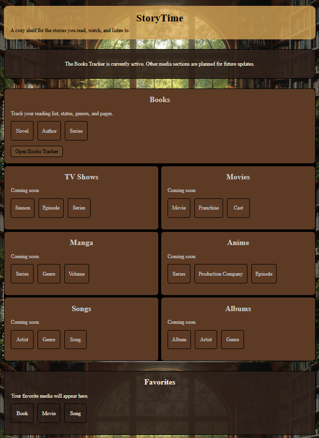
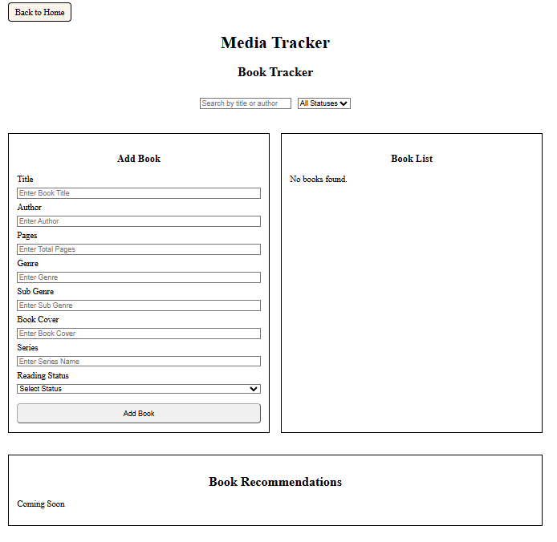
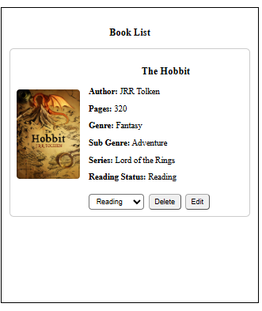

# StoryTime

StoryTime is a cozy full-stack book tracking web application that allows users to build and manage their personal reading library.

The project began as a front-end media tracker and evolved into a full-stack application using an Express backend, SQLite database, and the Open Library API.

## Live Demo

View the deployed frontend here:

https://zackbrisson.github.io/Media-Tracker/

## Current Features

- Cozy multi-page StoryTime interface
- Search for real books using the Open Library API
- Automatically fill book title, author, and cover information from search results
- Add books with:
  - Title
  - Author
  - Pages
  - Genre
  - Sub genre
  - Series
  - Book cover
  - Reading status
- Display books as visual cards
- Search your library by title or author
- Filter books by reading status
- Edit existing book details
- Change reading status directly from a book card
- Delete books
- Persistent book storage using SQLite
- Frontend validation for required fields
- Backend validation and API error handling
- Responsive layout for different screen sizes

## Architecture

StoryTime uses a separated frontend and backend architecture.

### Frontend

The frontend is built with:

- HTML
- CSS
- Vanilla JavaScript

It is deployed using GitHub Pages.

### Backend

The backend is built with:

- Node.js
- Express
- SQLite
- CORS

The Express API is deployed on Railway.

### Database

StoryTime uses SQLite for persistent book storage.

The production SQLite database is stored on a Railway persistent volume so book data survives application redeployments.

## API

The StoryTime backend provides REST API routes for book management:

- `GET /books` - Retrieve all books
- `POST /books` - Add a new book
- `PUT /books/:id` - Update an existing book
- `DELETE /books/:id` - Delete a book

## External API

StoryTime uses the Open Library API to search for books and retrieve information such as:

- Book title
- Author
- Cover image

Users can select a search result to automatically populate parts of the Add Book form.

## Tech Used

- HTML
- CSS
- JavaScript
- Node.js
- Express
- SQLite
- Open Library API
- REST APIs
- CORS
- Git
- GitHub
- GitHub Pages
- Railway

## What I Learned

Building StoryTime helped me practice and understand:

- Creating and handling HTML forms
- Working with JavaScript objects and arrays
- Rendering dynamic data to the DOM
- Using event listeners
- Working with `find()`, `filter()`, and `map()`
- Using `fetch()` for API requests
- Working with promises and `.then()`
- Connecting a frontend to a backend API
- Building REST API routes with Express
- Performing CRUD operations
- Working with SQLite databases
- Translating between JavaScript camelCase properties and SQL snake_case columns
- Handling frontend and backend validation
- Handling failed API responses with `response.ok`
- Using environment variables in deployed applications
- Configuring CORS for communication between separate frontend and backend deployments
- Deploying an Express API to Railway
- Using persistent storage for a production SQLite database
- Debugging deployment, routing, syntax, and CORS issues
- Using Git and GitHub throughout a project

## Future Improvements

StoryTime is currently focused on books, but the larger vision is to expand it into a general media tracker.

Possible future additions include:

- User accounts and authentication
- Individual user libraries
- Movies
- TV shows
- Manga
- Anime
- Songs
- Albums
- Shared genre and tag systems across different media types
- Recommendation features based on genres, tags, themes, and moods
- Additional accessibility and responsive-design improvements
- Migration to PostgreSQL if the application grows into a larger multi-user system

## Project Status

The Books version of StoryTime is complete and deployed as a full-stack portfolio project.

The current architecture uses:

GitHub Pages → Express API on Railway → SQLite database on a Railway persistent volume.

Future versions may expand StoryTime into a larger multi-user media tracking platform.

## Screenshots

### Homepage

### Books Tracker

### Books Tracker Example

